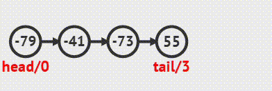
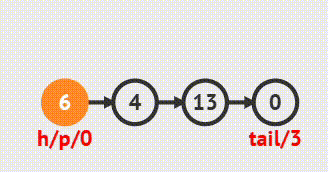

# АТД «Список»


В векторе удобно обращаться к элементам по номеру, но вставка или удаление в середине требуют сдвига соседей. В связном списке всё наоборот: если вы уже стоите в нужном месте, добавить или убрать элемент можно за `O(1)` без сдвигов остальной последовательности.

## Содержание

- [Зачем нужна позиция вместо разряда](#зачем-нужна-позиция-вместо-разряда)
- [Основные операции АТД «Список»](#основные-операции-атд-список)
- [Реализация на C через двусвязный список](#реализация-на-c-через-двусвязный-список)
- [Стандартные реализации в других языках](#стандартные-реализации-в-других-языках)
- [Итог](#итог)

---

## Зачем нужна позиция вместо разряда

В связном списке нет прямого доступа по номеру `r`: чтобы найти `r`-й элемент, пришлось бы идти с начала списка за `O(n)`. Зато имея ссылку на конкретный узел, легко вставить соседний или удалить сам узел за `O(1)`.

Чтобы не отдавать наружу «сырые» указатели `next` и `prev` (и не позволять случайно сломать связи), в АТД «Список» вводят понятие **позиции** — абстракции «места» элемента относительно его соседей. Пока элемент не удалён, его позиция остаётся привязанной к этому узлу, даже если элементы до или после него добавляли или удаляли.

## Основные операции АТД «Список»

**Навигация и чтение:**
- `first()`, `last()` — позиция первого и последнего элемента (ошибка, если список пуст).
- `before(p)`, `after(p)` — позиция до и после позиции `p`.
- `isFirst(p)`, `isLast(p)` — проверка, стоит ли `p` на краю списка.
- `element(p)` — значение, хранящееся в позиции `p`.

**Изменение:**
- `insertFirst(e)`, `insertLast(e)` — вставка в начало или конец, возвращает позицию нового элемента.
- `insertBefore(p, e)`, `insertAfter(p, e)` — вставка до или после позиции `p`, возвращает новую позицию.
- `remove(p)` — удаляет элемент в позиции `p` и возвращает его значение.
- `replaceElement(p, e)` — заменяет значение в позиции `p` на `e` и возвращает старое.
- `swapElements(p, q)` — меняет местами значения в позициях `p` и `q`.

## Визуализация некоторых операций списка

#### Вставка в конец (tail) за O(1)
<p align="left">
  
</p>

#### Удаление из позиции 3
<p align="left">
  
</p>

## Реализация на C через двусвязный список

Для двусвязного списка удобно использовать **сигнальные (фиктивные) узлы** `head` и `tail` по краям. Они не хранят полезных данных, но гарантируют, что у любого реального элемента всегда есть сосед слева и справа. Благодаря этому не приходится писать отдельные ветки для вставки в пустой список или удаления первого/последнего узла.

```c
#include <stdbool.h>
#include <stddef.h>
#include <stdio.h>
#include <stdlib.h>

// Узел двусвязного списка.
// Менять prev/next вручную извне не нужно — для этого есть функции списка.
typedef struct Node {
    int value;
    struct Node *prev;
    struct Node *next;
} Node;

// Список с сигнальными (фиктивными) узлами на краях:
// head стоит перед первым реальным узлом, tail — после последнего.
typedef struct {
    Node *head;
    Node *tail;
    size_t size;
} List;

List* listCreate(void) {
    List *list = malloc(sizeof(List));
    if (!list) {
        return NULL;
    }

    // Выделяем память под два сигнальных узла
    list->head = malloc(sizeof(Node));
    list->tail = malloc(sizeof(Node));
    if (!list->head || !list->tail) {
        free(list->head);
        free(list->tail);
        free(list);
        return NULL;
    }

    // В пустом списке head и tail указывают друг на друга
    list->head->prev = NULL;
    list->head->next = list->tail;
    list->tail->prev = list->head;
    list->tail->next = NULL;
    list->size = 0;

    return list;
}

void listFree(List *list) {
    if (!list) {
        return;
    }

    // Освобождаем все реальные узлы между head и tail
    Node *current = list->head->next;
    while (current != list->tail) {
        Node *next = current->next;
        free(current);
        current = next;
    }
    free(list->head);
    free(list->tail);
    free(list);
}

size_t listSize(const List *list) {
    return list->size;
}

bool listIsEmpty(const List *list) {
    return list->head->next == list->tail;
}

// Вставка нового узла сразу после узла p за O(1)
Node* listInsertAfter(List *list, Node *p, int value) {
    Node *newNode = malloc(sizeof(Node));
    if (!newNode) {
        return NULL;
    }

    // Настраиваем ссылки нового узла на соседей
    newNode->value = value;
    newNode->prev = p;
    newNode->next = p->next;

    // «Вплетаем» узел между p и p->next
    p->next->prev = newNode;
    p->next = newNode;

    list->size++;
    return newNode;
}

// Вставка в начало — это вставка сразу после сигнального узла head
Node* listInsertFirst(List *list, int value) {
    return listInsertAfter(list, list->head, value);
}

// Вставка в конец — это вставка после последнего реального узла (tail->prev)
Node* listInsertLast(List *list, int value) {
    return listInsertAfter(list, list->tail->prev, value);
}

// Удаление конкретного узла за O(1)
int listRemove(List *list, Node *node) {
    if (node == list->head || node == list->tail) {
        fprintf(stderr, "Ошибка: нельзя удалить сигнальный узел\n");
        exit(1);
    }

    int value = node->value;

    // Связываем левого и правого соседей напрямую друг с другом
    node->prev->next = node->next;
    node->next->prev = node->prev;

    free(node);
    list->size--;
    return value;
}

int listElement(const Node *node) {
    return node->value;
}

Node* listAfter(const List *list, const Node *p) {
    if (p->next == list->tail) {
        fprintf(stderr, "Ошибка: p — последняя позиция\n");
        exit(1);
    }
    return p->next;
}

Node* listBefore(const List *list, const Node *p) {
    if (p->prev == list->head) {
        fprintf(stderr, "Ошибка: p — первая позиция\n");
        exit(1);
    }
    return p->prev;
}

bool listIsFirst(const List *list, const Node *p) {
    return p->prev == list->head;
}

bool listIsLast(const List *list, const Node *p) {
    return p->next == list->tail;
}
```

### Пример использования

```c
#include "list.h"
#include <stdio.h>

int main(void) {
    List *list = listCreate();
    if (!list) {
        return 1;
    }

    listInsertFirst(list, 10);
    listInsertFirst(list, 20);
    listInsertFirst(list, 30);
    listInsertLast(list, 5);

    printf("Вперёд: ");
    for (Node *p = list->head->next; p != list->tail; p = p->next) {
        printf("%d ", p->value);
    }
    printf("\n");

    Node *second = list->head->next->next;
    printf("Удалён: %d\n", listRemove(list, second));

    listFree(list);
    return 0;
}
```

### Сложность операций

| Операция | Сложность |
| :--- | :--- |
| `insertFirst`, `insertLast`, `insertAfter` | `O(1)` |
| `remove(p)` | `O(1)` |
| `element(p)`, `before(p)`, `after(p)` | `O(1)` |
| Поиск по значению или доступ по номеру | `O(n)` |

## Стандартные реализации в других языках

- **C++:** `std::list` — двусвязный список, роль позиций играют итераторы (`insert` и `erase` за `O(1)` при наличии итератора).
- **Python:** в стандартной библиотеке нет классического двусвязного списка с `O(1)`-вставкой в произвольную позицию; для работы с концами используют `collections.deque` (`append`/`pop`/`appendleft`/`popleft` за `O(1)`, вставка по индексу — `O(n)`).
- **Java:** `LinkedList` — двусвязный список; вставка и удаление через `ListIterator` выполняются за `O(1)`.
- **C#:** `LinkedList<T>` — двусвязный список, где позицию представляет `LinkedListNode<T>`.

| Язык | Тип | Вставка/удаление по позиции |
| :--- | :--- | :--- |
| **C** | Ручной двусвязный список | `O(1)` |
| **C++** | `std::list` + итераторы | `O(1)` |
| **Python** | `collections.deque` | `O(1)` только с концов |
| **Java** | `LinkedList` + `ListIterator` | `O(1)` |
| **C#** | `LinkedList<T>` + `LinkedListNode<T>` | `O(1)` |

## Итог

- В связных списках удобнее работать через **позицию** (ссылку на узел), а не через порядковый номер.
- При наличии позиции вставка, удаление и переход к соседу выполняются за `O(1)`.
- Сигнальные узлы `head` и `tail` избавляют от множества граничных проверок.
- Поиск элемента по значению или по счёту от начала всё равно требует `O(n)`.
