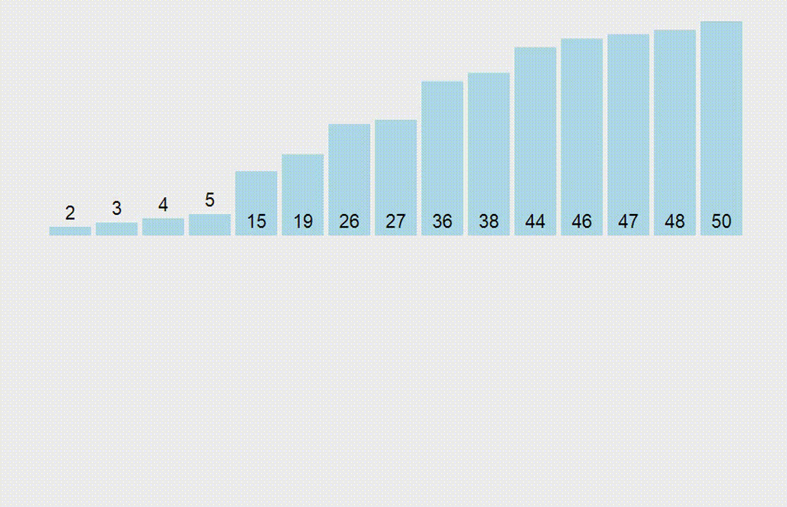
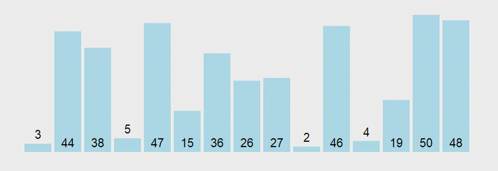
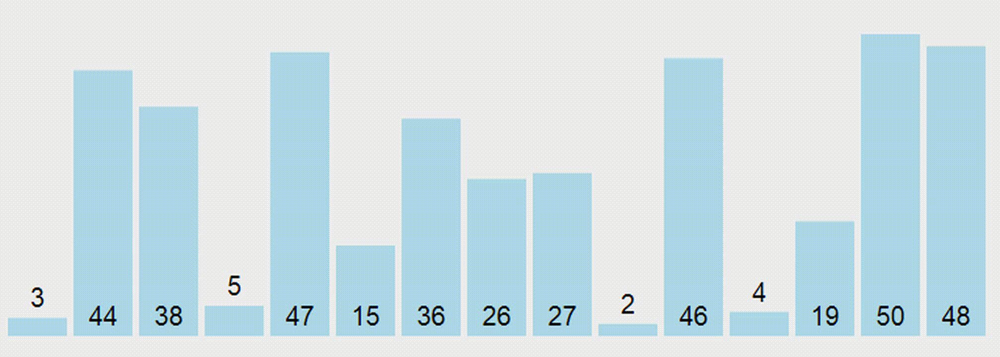

# Простые сортировки

**Простые сортировки** обычно работают за квадратичное время `O(n²)`. Они уступают эффективным алгоритмам на больших массивах, но легко читаются, не требуют сложной логики и отлично подходят для **маленьких наборов данных** (до 10–20 элементов) или **почти отсортированных** массивов.

## Содержание

- [Сортировка вставками](#сортировка-вставками)
- [Сортировка выбором](#сортировка-выбором)
- [Пузырьковая сортировка](#пузырьковая-сортировка)
- [Шейкер-сортировка](#шейкер-сортировка)
- [Сортировка Шелла](#сортировка-шелла)
- [Реализация на C](#реализация-на-c)
- [Итог](#итог)

---

## Сортировка вставками



Массив условно делится на **отсортированную** и **неотсортированную** части. На каждом шаге берём очередной элемент из неотсортированной части и вставляем его на нужное место в отсортированной части, сдвигая большие элементы вправо.

- **Сложность:** `O(n²)` в среднем и худшем случае, но `O(n)` на уже отсортированном массиве.
- **Устойчивость:** устойчива — равные элементы сохраняют свой исходный порядок.
- **Где полезна:** небольшие массивы и почти отсортированные данные (часто используется как финальный шаг в гибридных сортировках).

## Сортировка выбором



На каждом шаге ищем **минимальный** элемент в неотсортированной части и меняем его местами с первым элементом этой части.

- **Сложность:** `O(n²)` в любом случае — даже если массив уже отсортирован.
- **Устойчивость:** не устойчива — обмен через расстояние может поменять порядок равных элементов.
- **Особенность:** делает не более `n - 1` обменов, что выгодно, если само копирование элементов дорогое.
- **Вариация (квадратичный выбор):** при `n = k²` массив можно разбить на `k` групп по `k` элементов, искать минимумы в группах и среди их лидеров — это снижает сложность до `O(n√n)`.

## Пузырьковая сортировка



Проходим по массиву, сравниваем соседние элементы и меняем их местами, если они стоят в неверном порядке. С флагом обмена можно завершить работу досрочно, как только очередной проход прошёл без перестановок.

- **Сложность:** `O(n²)` в среднем и худшем случае, `O(n)` на отсортированном массиве с флагом.
- **Устойчивость:** устойчива.
- **На практике:** используется почти исключительно для обучения из-за большого числа обменов.

## Шейкер-сортировка

Модификация пузырьковой сортировки: проходы идут **поочерёдно** слева направо и справа налево, сужая рабочие границы. За счёт этого элементы быстрее двигаются в обе стороны.

- **Сложность:** `O(n²)` в среднем и худшем случае, `O(n)` на почти отсортированном массиве.
- **Устойчивость:** устойчива.

## Сортировка Шелла

Улучшение сортировки вставками: сначала элементы сравниваются и сдвигаются не с соседним элементом, а на большом **шаге `h`**, затем шаг постепенно уменьшают вплоть до `h = 1`. К моменту последнего прохода массив уже почти упорядочен.

- **Шаги:** классическая последовательность — `1, 4, 13, 40, 121, ...` (`h = 3h + 1`).
- **Сложность:** зависит от выбора шагов (для `3h + 1` типичная оценка около `O( \(n^{\frac{4}{3}}\))`), заметно быстрее `O(n²)`, но медленнее `O(n log n)`.
- **Устойчивость:** не устойчива.

## Реализация на C

```c
#include <stdbool.h>
#include <stddef.h>
#include <stdio.h>

// Сортировка вставками: сдвигаем элементы больше key вправо и ставим key на место
void insertionSort(int a[], size_t n) {
    for (size_t j = 1; j < n; j++) {
        int key = a[j];
        size_t i = j;
        while (i > 0 && a[i - 1] > key) {
            a[i] = a[i - 1];
            i--;
        }
        a[i] = key;
    }
}

// Сортировка выбором: ищем минимум в неотсортированной части и ставим в начало
void selectionSort(int a[], size_t n) {
    if (n < 2) {
        return;
    }
    for (size_t i = 0; i < n - 1; i++) {
        size_t minIndex = i;
        for (size_t j = i + 1; j < n; j++) {
            if (a[j] < a[minIndex]) {
                minIndex = j;
            }
        }
        if (minIndex != i) {
            int tmp = a[i];
            a[i] = a[minIndex];
            a[minIndex] = tmp;
        }
    }
}

// Пузырьковая сортировка с досрочным выходом, если обменов не было
void bubbleSort(int a[], size_t n) {
    if (n < 2) {
        return;
    }
    for (size_t i = 0; i < n - 1; i++) {
        bool swapped = false;
        for (size_t j = 0; j < n - 1 - i; j++) {
            if (a[j] > a[j + 1]) {
                int tmp = a[j];
                a[j] = a[j + 1];
                a[j + 1] = tmp;
                swapped = true;
            }
        }
        if (!swapped) {
            break;   // массив уже отсортирован
        }
    }
}

// Шейкер-сортировка: двусторонние проходы сужают границы [left..right]
void shakerSort(int a[], size_t n) {
    if (n < 2) {
        return;
    }
    size_t left = 0;
    size_t right = n - 1;
    bool swapped = true;

    while (swapped && left < right) {
        swapped = false;

        // Проход слева направо
        for (size_t j = left; j < right; j++) {
            if (a[j] > a[j + 1]) {
                int tmp = a[j];
                a[j] = a[j + 1];
                a[j + 1] = tmp;
                swapped = true;
            }
        }
        if (!swapped) {
            break;
        }
        right--;

        // Проход справа налево
        swapped = false;
        for (size_t j = right; j > left; j--) {
            if (a[j - 1] > a[j]) {
                int tmp = a[j];
                a[j] = a[j - 1];
                a[j - 1] = tmp;
                swapped = true;
            }
        }
        left++;
    }
}

// Сортировка Шелла: вставки с убывающим шагом h
void shellSort(int a[], size_t n) {
    size_t h = 1;
    while (h < n / 3) {
        h = 3 * h + 1;
    }

    while (h >= 1) {
        for (size_t i = h; i < n; i++) {
            int key = a[i];
            size_t j = i;
            while (j >= h && a[j - h] > key) {
                a[j] = a[j - h];
                j -= h;
            }
            a[j] = key;
        }
        h /= 3;
    }
}
```

## Итог

- **Вставками** — `O(n²)`, но `O(n)` на почти отсортированных данных; устойчива.
- **Выбором** — всегда `O(n²)`, зато минимум обменов (`≤ n - 1`); не устойчива.
- **Пузырьковая** и **шейкер** — `O(n²)`, подходят в основном для обучения; устойчивы.
- **Шелла** — ускоряет вставки за счёт убывающего шага `h` (`≈ O(n^(4/3))`); не устойчива.
