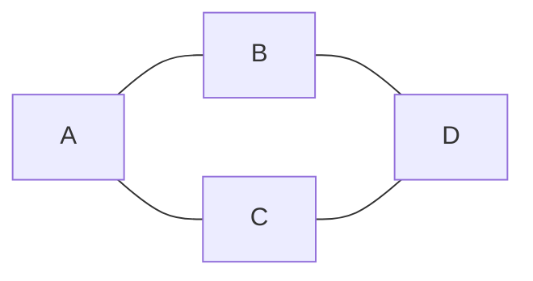

# Введение в графы

Представьте, что вы пишете навигатор. У вас есть города и дороги между
ними. Вопрос: «как доехать из Москвы в Казань быстрее всего?» — это
задача на графе. Города — вершины, дороги — рёбра, километры —
веса. Всё.

А теперь представьте, что вы пишете систему сборки проекта. У вас есть
модули и зависимости между ними. Вопрос: «в каком порядке их
компилировать?» — это тоже задача на графе. Модули — вершины,
«A зависит от B» — ребро. Тот же граф, другая задача.

Графы — это универсальный язык для описания **связей**. Дружбы в
соцсети, переходы между страницами сайта, зависимости пакетов,
маршруты общественного транспорта, дороги, сети, схемы метро,
генеалогические древа, компиляторные графы потока управления —
всё это графы. И именно поэтому графовые алгоритмы — это половина
практического программирования.

В этой главе мы не будем решать задачи. Мы разберёмся, **что такое
граф**, из чего он состоит и — самое главное — **как его хранить
в памяти**. Потому что от выбора структуры зависит скорость всех
алгоритмов, которые мы будем писать дальше.

## Содержание

- [Что такое граф](#что-такое-граф)
- [Терминология без скуки](#терминология-без-скуки)
- [Три способа хранить граф](#три-способа-хранить-граф)
- [Матрица смежности](#матрица-смежности)
- [Список смежности](#список-смежности)
- [Список рёбер](#список-рёбер)
- [Сравнение представлений](#сравнение-представлений)
- [Реализация на C](#реализация-на-c)
- [Итог](#итог)

---

## Что такое граф

**Граф** — это пара `G = (V, E)`, где `V` — множество вершин (узлов),
а `E` — множество рёбер (связей между вершинами).



Здесь `V = {A, B, C, D}`, `E = {(A,B), (A,C), (B,D), (C,D)}`.

Графы бывают разные:

- **Неориентированный** — ребро `(A, B)` означает «A связан с B» и
  «B связан с A» одновременно. Дорога в обе стороны.
- **Ориентированный** (орграф) — ребро `(A, B)` означает «из A можно
  попасть в B», но не наоборот. Односторонняя дорога. Обозначается
  стрелкой: `A → B`.
- **Взвешенный** — у каждого ребра есть число (вес, стоимость, длина).
  Например, километры между городами.
- **Мультиграф** — между двумя вершинами может быть несколько рёбер
  (параллельные дороги). В этой главе такие не рассматриваем — почти
  всегда можно свести к обычному графу.
- **Гиперграф** — ребро соединяет сразу три и более вершин. Тоже
  экзотика, в курсе не встречается.

> **Главная мысль:** граф — это способ описать **связи**. Всё, что
> можно сформулировать как «X связан с Y» (дорога, зависимость,
> дружба, переход), — это граф. И задачи на графах — это задачи
> про связи.

---

## Терминология без скуки

Формальные определения нужны, но их легко забыть. Давайте через аналогии.

- **Вершина** (vertex, node) — точка. Город, человек, модуль, страница.
- **Ребро** (edge) — связь. Дорога, дружба, зависимость, ссылка.
- **Степень вершины** (degree) — сколько рёбер в неё входит. У города —
  сколько дорог. В орграфе различают **входящую** и **исходящую**
  степень.
- **Путь** — последовательность вершин, где каждая пара соседних
  соединена ребром. `A → C → D` — путь из A в D.
- **Длина пути** — число рёбер в пути (или сумма весов, если граф
  взвешенный). Осторожно: в невзвешенном графе «длина» — это число
  рёбер, а не километры.
- **Цикл** — путь, который начинается и заканчивается в одной вершине
  и больше нигде не повторяется. `A → B → D → C → A` — цикл.
- **Связный граф** — из любой вершины можно дойти до любой. Иначе —
  граф распадается на **компоненты связности**.
- **Дерево** — связный граф **без циклов**. Да, дерево — это частный
  случай графа. Всё, что вы знаете про деревья, — это графы с
  дополнительным ограничением.

> **Важно:** дерево — это граф без циклов. Любое дерево с `n` вершинами
> имеет ровно `n − 1` рёбер. Если в связном графе с `n` вершинами
> больше `n − 1` рёбер — в нём точно есть цикл.

---

## Три способа хранить граф

Вот здесь начинается инженерия. Граф — это абстракция, а в памяти
его можно разложить по-разному. Три классических способа:

1. **Матрица смежности** — двумерный массив `n × n`.
2. **Список смежности** — массив списков: для каждой вершины — список
   её соседей.
3. **Список рёбер** — массив пар (или троек, если взвешенный).

У каждого — своя ниша. Разберём по порядку.

---

## Матрица смежности

Двумерный массив `adj[n][n]`, где `adj[i][j] = 1`, если есть ребро
из `i` в `j`, и `0` иначе. Для взвешенного графа вместо `1` хранят
вес, а отсутствие ребра обозначают «бесконечностью» (или специальным
значением вроде `INT_MAX`).

```
     A  B  C  D
  A [ 0  1  1  0 ]
  B [ 1  0  0  1 ]
  C [ 1  0  0  1 ]
  D [ 0  1  1  0 ]
```

**Плюсы:**
- Проверка «есть ли ребро `i → j`» — за `O(1)`. Просто `adj[i][j]`.
- Просто реализовать.
- Удобно для **плотных** графов (много рёбер).

**Минусы:**
- Память — `O(n²)`. Для миллиона вершин это `10¹²` ячеек. Нереально.
- Перебор соседей вершины — `O(n)`, даже если соседей всего два.
  Для **разреженных** графов это катастрофа.

> **Главная мысль:** матрица смежности — это «таблица всех пар».
> Хороша, когда граф плотный и вершин немного. Плоха, когда вершин
> много, а рёбер мало.

---

## Список смежности

Для каждой вершины храним **список** её соседей. В C — массив
динамических массивов или массив связных списков.

```
A: [B, C]
B: [A, D]
C: [A, D]
D: [B, C]
```

**Плюсы:**
- Память — `O(n + m)`, где `m` — число рёбер. Для разреженных графов
  это радикально меньше `O(n²)`.
- Перебор соседей вершины — `O(degree)`, а не `O(n)`. Это то, что
  нужно почти всем алгоритмам (BFS, DFS, Дейкстра).

**Минусы:**
- Проверка «есть ли ребро `i → j`» — `O(degree(i))`, а не `O(1)`.
  Но на практике это редко нужно.
- Чуть сложнее реализация (динамические массивы или списки).

> **Главная мысль:** список смежности — **дефолт** для 90% задач.
> BFS, DFS, Дейкстра, топосорт, Прим — все они хотят перебирать
> соседей, и список смежности даёт это за `O(degree)`. Если
> сомневаетесь — берите список смежности.

---

## Список рёбер

Просто массив всех рёбер: `(u, v)` или `(u, v, weight)` для
взвешенного.

```
[(A,B), (A,C), (B,D), (C,D)]
```

**Плюсы:**
- Память — `O(m)`, минимально возможная.
- Идеален для алгоритмов, которые **сортируют рёбра** — например,
  Краскал (MST).
- Просто читать из файла.

**Минусы:**
- Нет быстрого способа узнать соседей вершины. Приходится перебирать
  все рёбра.
- Для BFS/DFS/Дейкстры — плохо.

> **Важно:** список рёбер — это не «замена» списку смежности, а
> **дополнение**. Часто хранят и то, и другое, а то и все три
> представления сразу — каждое для своей задачи.

---

## Сравнение представлений

| Критерий | Матрица смежности | Список смежности | Список рёбер |
|----------|-------------------|------------------|--------------|
| Память | `O(n²)` | `O(n + m)` | `O(m)` |
| Проверка ребра `u→v` | `O(1)` | `O(deg(u))` | `O(m)` |
| Перебор соседей `u` | `O(n)` | `O(deg(u))` | `O(m)` |
| Добавление ребра | `O(1)` | `O(1)` | `O(1)` |
| Удаление ребра | `O(1)` | `O(deg(u))` | `O(m)` |
| Когда использовать | Плотный граф, `n` мало | Почти всегда | Краскал, чтение из файла |

**Правило большого пальца:**
- Граф плотный (`m ≈ n²`) → матрица смежности.
- Граф разреженный (`m ≈ n`) → список смежности.
- Нужно сортировать рёбра → список рёбер.

В реальной жизни почти все графы **разреженные**. Соцсеть с миллионом
пользователей: у среднего человека 150 друзей, а не миллион. Дорожная
сеть: у города 3–5 дорог, а не тысячи. Поэтому **список смежности
побеждает почти всегда**.

---

## Реализация на C

Возьмём список смежности — он самый практичный. Реализуем через
массив «голов» и связные списки рёбер. Альтернатива — динамические
массивы (`int **neighbors; int *degree;`), но связные списки проще
и не требуют реаллокации.

```c
#include <stdio.h>
#include <stdlib.h>

/* Узел связного списка соседей.
 * Хранит номер соседней вершины и вес ребра (для взвешенного графа). */
typedef struct AdjNode {
    int to;      /* номер соседней вершины */
    int weight;  /* вес ребра (0 для невзвешенного) */
    struct AdjNode *next;    /* следующий сосед в списке */
} AdjNode;

/* Граф на списке смежности.
 * head[i] — голова списка соседей вершины i.
 * n — число вершин, m — число рёбер (для справки). */
typedef struct {
    AdjNode **head;
    int n;
    int m;
} Graph;

/* Создание графа с n вершинами и без рёбер. */
Graph* graphCreate(int n) {
    Graph *g = malloc(sizeof(Graph));
    if (g == NULL) return NULL;
    g->n = n;
    g->m = 0;
    g->head = calloc(n, sizeof(AdjNode*));   /* все головы — NULL */
    if (g->head == NULL) { free(g); return NULL; }
    return g;
}

/* Добавление ребра u → v с весом w.
 * Для неориентированного графа вызывайте дважды: (u,v) и (v,u). */
void graphAddEdge(Graph *g, int u, int v, int w) {
    AdjNode *node = malloc(sizeof(AdjNode));
    if (node == NULL) return;
    node->to = v;
    node->weight = w;
    /* Вставляем в начало списка — O(1), порядок соседей нам не важен. */
    node->next = g->head[u];
    g->head[u] = node;
    g->m++;
}

/* Освобождение памяти. Проходим по всем спискам и освобождаем узлы. */
void graphFree(Graph *g) {
    if (g == NULL) return;
    for (int i = 0; i < g->n; i++) {
        AdjNode *cur = g->head[i];
        while (cur != NULL) {
            AdjNode *next = cur->next;
            free(cur);
            cur = next;
        }
    }
    free(g->head);
    free(g);
}

/* Печать графа — для отладки. */
void graphPrint(Graph *g) {
    for (int i = 0; i < g->n; i++) {
        printf("%d:", i);
        for (AdjNode *cur = g->head[i]; cur != NULL; cur = cur->next) {
            printf(" → %d(w=%d)", cur->to, cur->weight);
        }
        printf("\n");
    }
}

int main(void) {
    /* Граф из примера выше: A=0, B=1, C=2, D=3. */
    Graph *g = graphCreate(4);
    graphAddEdge(g, 0, 1, 1);   /* A-B */
    graphAddEdge(g, 1, 0, 1);   /* B-A (неориентированный) */
    graphAddEdge(g, 0, 2, 1);   /* A-C */
    graphAddEdge(g, 2, 0, 1);   /* C-A */
    graphAddEdge(g, 1, 3, 1);   /* B-D */
    graphAddEdge(g, 3, 1, 1);   /* D-B */
    graphAddEdge(g, 2, 3, 1);   /* C-D */
    graphAddEdge(g, 3, 2, 1);   /* D-C */

    graphPrint(g);
    graphFree(g);
    return 0;
}
```

### Что важно в реализации

- **`calloc` для `head`** — обнуляет указатели. Иначе в массиве будет
  мусор, и `graphFree` упадёт.
- **Вставка в голову списка** — `O(1)`. Порядок соседей нам не важен,
  поэтому не нужно искать хвост.
- **Неориентированный граф** — вызываем `graphAddEdge` дважды. Это
  стандартный приём, не надо заводить отдельный флаг.
- **Вес `0` для невзвешенного** — просто соглашение. Можно хранить
  `1` или вообще не хранить поле `weight`, но единая структура
  удобнее.
- **`graphFree`** — обязательно освобождаем все узлы списков, потом
  сам массив `head`, потом граф. Порядок важен.

> **Главная мысль:** список смежности — это массив «голов» плюс
> связные списки. Вставка `O(1)`, перебор соседей `O(degree)`, память
> `O(n + m)`. Это рабочая лошадка всех графовых алгоритмов.

---

## Итог

- **Граф** — это `G = (V, E)`: вершины и рёбра. Универсальный язык для
  описания связей.
- Графы бывают **ориентированные** / **неориентированные**,
  **взвешенные** / **невзвешенные**.
- **Дерево** — это граф без циклов. `n` вершин, `n − 1` рёбер.
- Три способа хранения: **матрица смежности**, **список смежности**,
  **список рёбер**.
- **Матрица** — `O(n²)` памяти, `O(1)` проверка ребра. Для плотных
  графов.
- **Список смежности** — `O(n + m)` памяти, `O(degree)` перебор
  соседей. **Дефолт** для 90% задач.
- **Список рёбер** — `O(m)` памяти. Для Краскала и чтения из файла.
- В C: массив «голов» + связные списки соседей. Вставка `O(1)`,
  освобождение — обход всех списков.
- Все обходы графа (BFS, DFS) работают за `O(V + E)` именно потому,
  что список смежности позволяет перебирать соседей за `O(degree)`.
  Это и есть стандартная сложность графовых алгоритмов.
